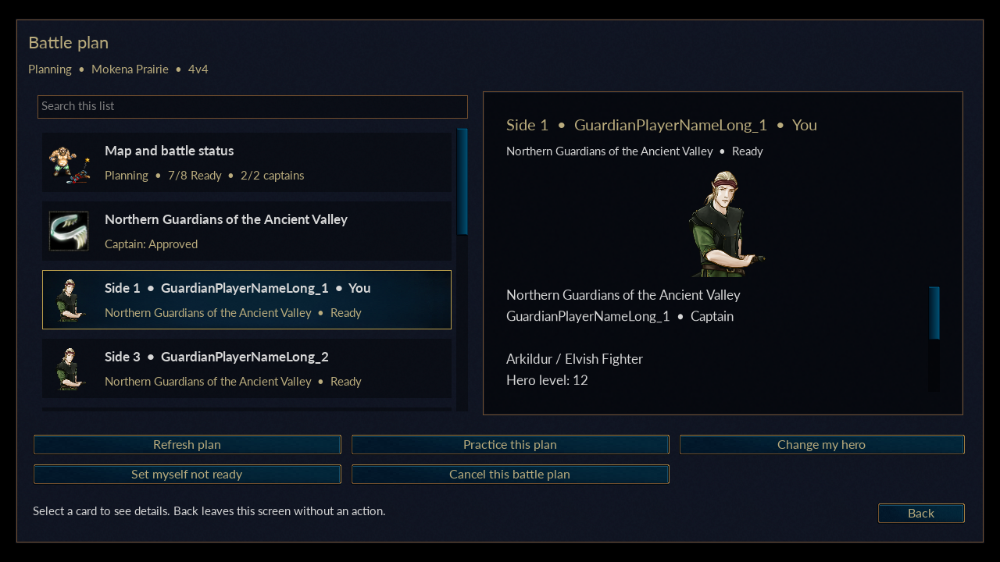
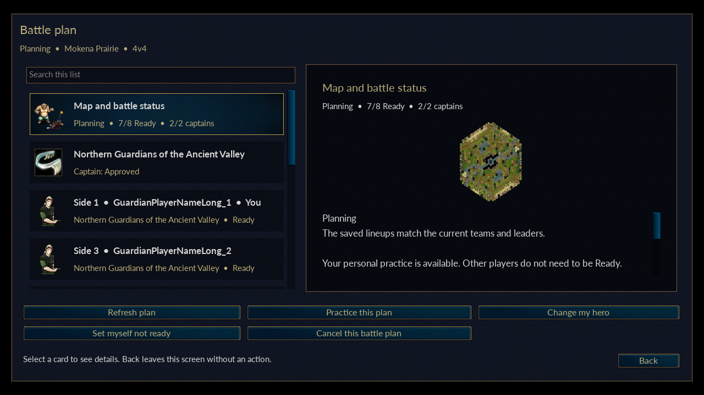
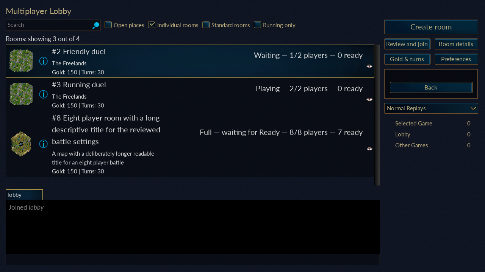

# Battle interface — 1192620

This update presents the existing heroes, team plans and individual rooms using the game's native Campaigns and Multiplayer widgets. It changes navigation and presentation; it does not introduce a new battle service, database schema, progression rule or reward source. Windows and LDPlayer acceptance follows `NEXT_TEST.md` after the completed build is delivered.

## Actual renderer previews

These captures use the real Wesnoth GUI2 renderer with illustrative fixture accounts and teams; they are not screenshots of your Windows database.

## Shared browsing controls

The new views have a searchable card list and a detail panel. Selecting a card changes its preview only. An explicitly labelled button performs an action; Back leaves without that action. Views keep a useful selected row when returning or refreshing. Empty lists explain the next available action, and selection-dependent buttons are disabled when there is no selectable result.

Hero portraits, unit pictures, team icons and map previews come from the existing pinned game data. The layout is generated by the client, so this interface does not require a new OBB or edits to the original data pack.

## Heroes and forms

Heroes → My heroes opens the owned collection with each hero's permanent level, earned forms and experience progress. View earned forms shows a portrait and the selected form's scaled hit points and attacks. A player with no heroes sees campaign guidance.

Battle selection uses two explicit steps: choose a hero, then inspect and use an earned form. The account and ownership are checked again before returning the choice. Merely viewing a hero does not select it for a battle or change its progress. Story campaigns keep authored statistics; the existing permanent battle scaling remains unchanged.

## Individual rooms

Multiplayer opens the native live dashboard. Room rows show a map preview, room name and identifier, status, player occupancy, Ready count, starting gold and turn limit. Search finds room or map names. Visible checkboxes filter Individual rooms, Standard rooms, Open places and Running only. Gold & turns opens additional filters; Apply filters commits them, while Back discards uncommitted changes. These dashboard filters do not overwrite the old social-filter preferences and reset when the dashboard is opened again.

Individual rooms are selected by default. Enable Standard rooms to include ordinary manual, computer-side and saved-game rooms. Chat, Preferences, Back and the native room-creation flow remain available. Unsupported public-server matchmaking queues, profile links and match-history buttons are hidden.

Create room retains the native map and settings screen. For an eligible new standalone map, choose Individual battle room or Standard multiplayer. Individual creation offers common starting gold and a map/seat preview before Publish room. It creates a public room without an area or persistent-team requirement. Standard multiplayer retains its existing manual-start and computer-side behavior.

Review and join displays the published map, rules, timer and each side's team, economy, hero and readiness before Agree and join. Room details remains useful for full or running rooms; Observe is offered only when allowed. Reviewing a room does not reserve a seat. Admission still checks current capacity and the reviewed settings revision.

In the player lobby, the player's hero control opens My battle side. Choose hero, inspect Room settings, then select Ready. Individual Ready requires a separate review of the current room settings. The native side list and room status reflect server acknowledgements; a pending request cannot authorize a start. The full configured room starts automatically only after every player has an owned hero and is Ready. Changes to players, heroes or rules still invalidate consent. The host has no manual-start bypass for individual rooms.

## Teams and fixed battle plans

Teams opens the current roster and team summary, or guidance for finding or creating a team. Explicit buttons lead to Battle plans, New battle, Captain orders, Applications, Find teams, Area rankings and team management. Existing captain permissions and server checks still determine which changes are allowed.

Team and area directories support paging. A proposal previews the map, opponent and both fixed lineups. Select / remove changes the local lineup only; Use this lineup accepts a complete selection. Send battle proposal performs the separately confirmed request.

A battle plan shows its map, state, both teams, captain approvals and each selected player's hero and readiness together. Available actions retain their existing eligibility checks. Cancelled and completed plans show historical readiness and inactive approvals. Personal practice, shared battle admission, result submission and replay access retain their existing policies and separate confirmations. Refresh plan loads a fresh server snapshot.

## Verification boundary

The individual-room component passes 49 production-controller groups under address/undefined-behavior sanitizers and compiles eight actual pinned-engine translation units on the VPS. Fourteen actual SDL software-rendered dashboard/staging captures cover 1280×720 and 1920×1080, live checkbox filtering, bounded controls, the eight-seat scrollbar and disabled manual Start. The renderer substitutes socket polling and account data with fixtures; it does not prove live Windows admission or LDPlayer input.

Evidence for that component is `build/audit-battle-ui-individual-20261024/validation.json`. Shared-browser, hero and team checks are recorded separately in the release audit. The shared-browser renderer additionally passes38 captures at both sizes, including actual team view models, portable hero artwork, all three team maps, search/empty states, Enter/Back and explicit selection. Final APK/build and preservation evidence is recorded in [VERIFICATION_1192620.json](VERIFICATION_1192620.json).

The current `runtime-v2`, trusted server, accounts, teams, heroes, saves and original game data are retained. No fresh database initialization, profile reimport or automatic retry of a game mutation is part of this interface update.
