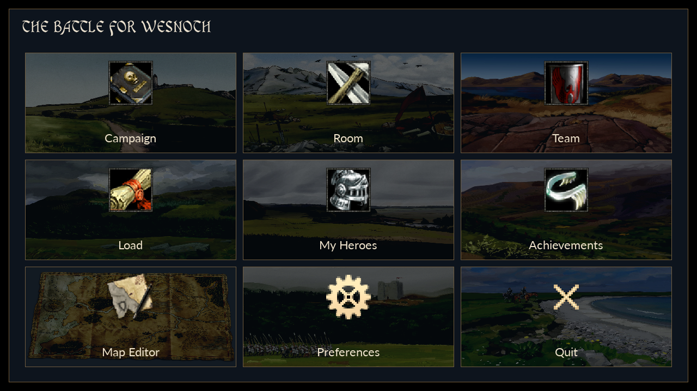
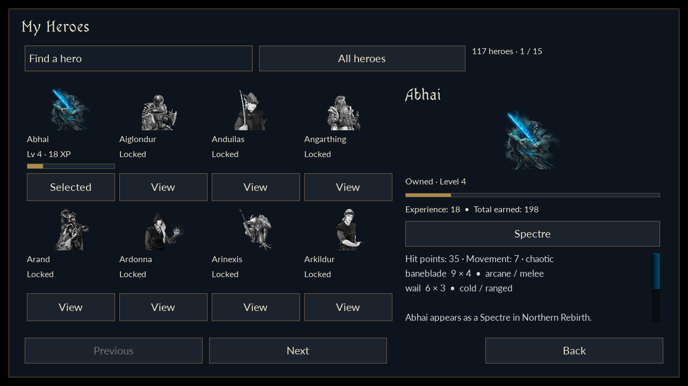
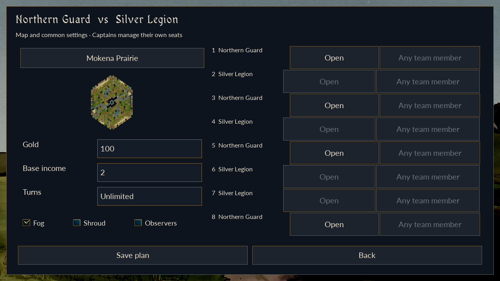

# Product interface and flexible battles — 1192621

This release uses the existing Wesnoth 1.19.26 engine and game data. It replaces the product navigation and introduces flexible Team plans. Installation and acceptance instructions are in [PRODUCT_ACCEPTANCE_1192621.md](PRODUCT_ACCEPTANCE_1192621.md). Windows and LDPlayer observations are recorded separately from VPS verification.

## Player interface

The application opens a painted loading screen, validates its bundled public configuration and interface assets, prepares the existing game data, and opens Login. Signup replaces Login. Successful authentication goes directly to the nine illustrated destinations: **Campaign, Room, Team, Load, My Heroes, Achievements, Map Editor, Preferences, Quit**. The native Achievements, editor and preferences remain available.

Quit and the authentication close button attempt bounded server logout, clear the local session and close the Android task. Reopening requires authentication. A lost required local account connection clears the session and displays a concise warning. Internet access is not needed while the local services remain reachable.

The client build reads only `WESNOTH_PUBLIC_PROFILE_PATH` from its ignored `.env`. Unrelated assignments are neither evaluated nor packaged. Certificate purpose, expiry, numeric address and fingerprint are checked before building. The signed APK contains the public profile and an exact interface asset manifest; private keys, database credentials, `.env` and account passwords are excluded. The older imported profile remains unused for rollback.

## Campaign and heroes

The native campaign browser displays story artwork, synopsis, difficulty and length, with a reward preview for the selected story. Discoverable characters and their source campaigns come from the pinned catalogue. Branches can change which characters appear; the preview does not promise every hero in one playthrough.

Rewards remain scenario based. A legitimate confirmed victory unlocks eligible participating named heroes/forms and credits the existing scenario reward rules. Defeat and duplicate delivery grant no additional permanent reward. Story saves remain account, generation and playthrough bound. Hero training is removed from navigation; its earned progress and historical records remain.

My Heroes presents all **117 canonical characters**, with search and All/Owned/Locked filters. The gameplay catalogue contains 346 advancement forms; earned forms are selectable inside an owned hero’s profile. Owned cards show permanent level and XP. Locked cards remain selectable for portrait, biography and verified discovery information, without unearned forms or owned statistics. Owned profiles additionally expose earned forms, abilities and combat statistics. Presentation metadata does not rename gameplay identities. The asset audit reuses 115 supplied portraits and adds two original portraits for genuinely missing characters, Thea and Refumee; provenance is recorded in `tools/native-account-game/ui-assets/PROVENANCE.md`.

Permanent hero level is shared across a character's forms. Existing advancement mathematics remain: the next level costs `5L² + 15` XP; multiplayer forms gain 2% of base HP and 1% of base damage per additional permanent level, rounded half upward. Native movement, strike count, resistances and abilities remain those of the selected form. Story play retains its authored character statistics.

## Individual Room

The global Room dashboard has no area restriction. It lists live occupancy, map, state and rules, with name/map search, capacity and availability filters. Creating a room uses one settings page. Every side receives the same starting gold and effective base income: defaults are 100 and 2, with unlimited turns. Allowed gold is 0–1000; effective income is 0–20; finite turns are 1–1000. The engine's additive income field receives `effective income - 2`.

Every configured seat is human. Each player selects an owned hero before Ready. The room starts only when full and everyone is Ready for its current revision. Settings, hero and membership changes invalidate previous readiness. Individual battles grant no permanent hero XP, Team XP or rating. Started Individual rooms do not support player rejoin or takeover; Team reconnect is a separate implemented path.

There is no Standard Multiplayer entry or network resumption of its old saves. Load retains campaign saves and local/replay viewing. Old network scenario uploads are rejected by the native server as well as hidden in the interface.

## Team plans and shared execution

Real opposing teams and area rules remain. A captain may publish an incomplete draft. Plans, Roster and History share the Team workspace. Each captain configures only their own sides as Open, Reserved, AI or Closed. Reserved seats name a current teammate; Open seats can be claimed by an eligible teammate. AI chooses among the pinned Default-era faction/leader combinations and has no account or permanent hero. Closed sides create no units.

Both captains approve the same revision of the common map and rules. Human players choose an owned hero/form and Ready. Material settings, slots or hero changes clear approvals and readiness; readiness alone does not revise configuration. Preparation requires equal enabled side counts, at least one human per team, all human seats occupied and Ready, and both current approvals.

Player reservations replace team-wide exclusivity. Disjoint members of the same team may play concurrent battles; one player cannot hold two prepared/running network seats. Preparation clears those players' readiness in competing plans. All human engines must load the identical scenario before play. Five-minute preparation expiry releases the matching reservations and requires fresh readiness.

The lowest numbered participating human side hosts native AI execution for the explicitly assigned AI sides. Every other human controls only their own side. Host disconnection pauses the room, and the same account can reconnect and replay accepted history. Control is never silently transferred or converted to AI. Closed sides are skipped without renumbering the remaining map sides. Authorized observers have no controller, result journal or rewards.

## Settlement and history

Custom configurations award participating human hero XP and Team XP. Rating requires the approved full-human preset: 100 gold, effective income 2, unlimited turns, fog on, shroud and observers off, with every map seat human. Elo K remains 24.

| Outcome | Selected human hero XP | Team XP |
| --- | ---: | ---: |
| Win | 20 | 100 |
| Loss | 10 | 25 |
| Draw | 10 | 50 |

AI and observers receive no persistent reward. Human result evidence and both captains' confirmations precede exactly-once settlement. Concurrent transactions serialize updates so one battle cannot overwrite another's accumulated XP or rating. Cancellation releases only its own reservations and grants no reward.

Current members of either team may view its completed history and available replays. Recorded participants and captains retain historical access after leaving. History is paginated and retains settings, cancellations and results. Legacy readers preserve completed/cancelled records and old replay bytes.

New plans retain their recorded captains from publication. Legacy history uses the participant, approval and captain evidence actually saved at the time; a departed captain never recorded in an old cancelled plan cannot be reconstructed reliably.

## Upgrade and operating boundary

Schema 2 migrates explicitly to schema 3 **inside the existing `runtime-v2`**. The helper requires stopped services, no active battles and a verified cold backup. Its generation-bound journal supports interrupted/resumed migration. Existing accounts, password hashes, heroes, XP, teams, identifiers and replays remain. Old drafts become reserved-human plans with their original snapshots retained and fresh consent required. Old protocol-2 clients are rejected before account or battle dispatch with an update-required response and a fixed server diagnostic. An already installed old APK may display its compiled unsupported-response text; it cannot gain a new dialog without updating. Schema-2 backups can still be restored into an isolated destination without activating it.

The five services retain their ports: MongoDB 27018, admin 18765, account bridge 15001, Team battles 15002 and native Rooms 15000. The original package identity/signer, OBB, saves, pinned tools, prior stages and recovery journals remain. This is the agreed local full-strength game: the service checks identity, admission, controller ownership, ordering and settlement, but does not independently simulate every combat action.

One LDPlayer can use separately authenticated companion processes for additional seats. Those seats execute real native AI and networking; they do not establish multiple-human touch or keyboard usability. The Windows checklist retains this distinction and stops at the first unexpected result for a targeted fix and retest.

## Rendered interface previews

These captures come from the actual native GUI2/SDL renderer at 1280×720, using pinned game artwork and disposable fixture accounts. They are not mockups or LDPlayer captures. The same layouts are checked at 1920×1080; physical keyboard, touch scaling and Android task behavior remain Windows acceptance checks.

Additional actual captures: [Login](images/product-1192621-login-775b3f7b2e52.png), [Signup](images/product-1192621-signup-d3f8a889c488.png), [Campaign rewards](images/product-1192621-campaign-2e588b6d341e.png), [Room creation](images/product-1192621-room-create-50f1ea5724d9.png), [live Room dashboard](images/product-1192621-room-dashboard-8af6e20308f0.png), [Room seats](images/product-1192621-room-staging-5782f3c04b21.png), [Team hub](images/product-1192621-team-hub-92ae6b57a6da.png), [selected Team plan](images/product-1192621-team-workspace-69de12fb8120.png).

The machine-readable [verification record](VERIFICATION_1192621.json) contains the final source/artifact hashes, checks and preservation counts, with separate scopes for native rendering, native engine/network tests, Android compilation and pending Windows acceptance.
